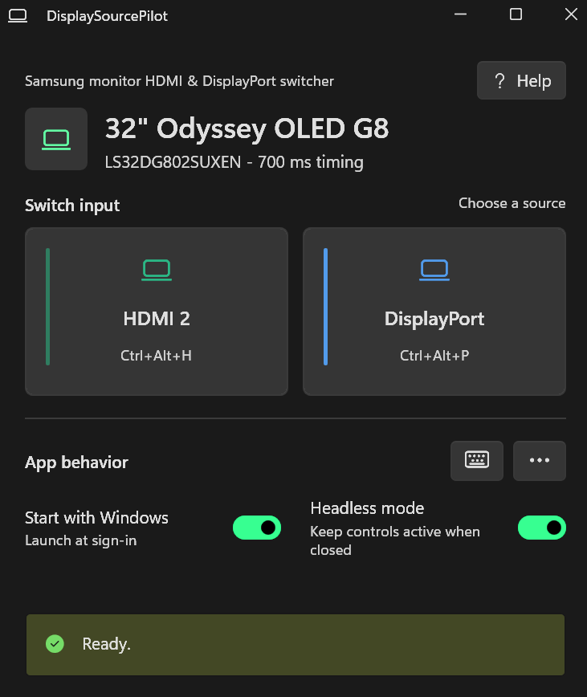

# DisplaySourcePilot

DisplaySourcePilot is a Windows monitor input switcher for Samsung and DDC/CI displays. It changes a configured monitor between HDMI and DisplayPort from the app, a global hotkey, a desktop shortcut, or the command line.



## Requirements

- Windows 10 version 1809 or newer
- An x64 or ARM64 PC
- A monitor with one of these control paths:
  - DDC/CI input control through VCP code `0x60`
  - Samsung Tizen local remote control on port `8001` or `8002`

For DDC/CI, enable DDC/CI in the monitor menu. Some docks, adapters, KVM switches, and GPU drivers do not pass DDC/CI commands through.

For Samsung network control, the PC and monitor must be on the same private network. Corporate and guest networks commonly block local-device discovery.

## Install

[Download the latest Windows installer](https://github.com/HogmanGlenn/DisplaySourcePilot/releases/latest/download/DisplaySourcePilot-Setup.exe)

1. Download `DisplaySourcePilot-Setup.exe`.
2. Run it and open DisplaySourcePilot.
3. Choose the monitor and the HDMI and DisplayPort inputs to use.
4. Approve DisplaySourcePilot on the Samsung monitor if a pairing prompt appears.

The installer includes both x64 and ARM64 builds and automatically installs the correct version for the PC.

If a Samsung monitor is not discovered automatically, expand **Samsung monitor not listed?** and enter its private IPv4 address. Models without a verified source layout use a guided source check. The app requires confirmation of the exact highlighted input before it saves a route.

The current installer is not Authenticode-signed, so Windows may show an unknown-publisher warning. Verify that the installer came from this repository before running it.

## Use

Select HDMI or DisplayPort from the main window. The two global shortcuts are shown under the source buttons and can be changed from the keyboard button.

Open the options menu to create an HDMI or DisplayPort desktop shortcut for the configured monitor. The shortcut includes a monitor identity check, so it will not silently control a different monitor after setup changes.

When headless mode is enabled, closing the window keeps the shortcuts and command interface active without leaving a visible window or console. Use **Quit DisplaySourcePilot** from the options menu to stop it completely.

The same actions are available from PowerShell, desktop shortcuts, or other automation:

```powershell
$app = "$env:LOCALAPPDATA\Programs\DisplaySourcePilot\DisplaySourcePilot.exe"
& $app --switch hdmi
& $app --switch displayport
& $app --confirm hdmi
& $app --confirm displayport
```

The confirmation commands are recovery actions for Samsung monitors. They set the input currently visible on the monitor. If DisplaySourcePilot is waiting to finish a requested switch, it continues that switch after the confirmation.

## Safety

Samsung source menus are not consistent across models. DisplaySourcePilot only sends short, validated navigation routes and stops treating the input as known if a command may have failed partway through. It asks for confirmation before another source command is allowed.

Samsung does not report the active input through its local remote API. If you change inputs with the monitor remote, choose **Set current input** from the options menu. Requesting the same source DisplaySourcePilot last recorded also opens this check instead of claiming the source is already selected.

Only the tested Odyssey OLED G8 G80SD layout is selected automatically. Other Samsung models use the guided source check instead of relying on a guessed route.

Samsung can hide an HDMI or DisplayPort tile when the connected device is asleep or not producing a signal. If the target is missing during the source check, DisplaySourcePilot closes the menu and waits instead of navigating to another tile. Wake the device or restore its signal, then restart the check. Use **Repair Samsung source route** from the options menu if a saved menu layout changes.

## Troubleshooting

**The monitor is not listed**

- Enable DDC/CI in the monitor menu.
- Try a direct display cable instead of a dock or KVM.
- For a Samsung smart monitor, enter its IP address manually.
- Confirm that Windows and the monitor are on the same private network.

**A Samsung switch was interrupted**

Open DisplaySourcePilot and confirm the input currently visible on the monitor. No source command is sent during confirmation.

**A Samsung input is not shown in the source menu**

Wake the device connected to that input and confirm it is sending a signal. In the source check, choose **Target input is not listed**, then restart the check after the input returns. The app cannot safely select an input that Samsung has removed from its menu.

**A keyboard shortcut is unavailable**

Choose another shortcut. Windows rejects a global shortcut when another application has already registered it.

Application logs are stored at `%LOCALAPPDATA%\DisplaySourcePilot\app.log`. Pairing tokens and other secrets are not written to the log.

## Privacy

DisplaySourcePilot has no telemetry and does not use a cloud service. DDC/CI commands remain on the PC. Samsung discovery and control stay on the local private network. Pairing tokens and trusted monitor certificate fingerprints are stored in Windows Credential Manager.

## Build

Install the .NET SDK version specified in [`global.json`](global.json). Building the installer also requires [Inno Setup 6](https://jrsoftware.org/isinfo.php).

From PowerShell:

```powershell
.\build\Build-Release.ps1
```

The script restores locked dependencies, runs the core tests, publishes self-contained x64 and ARM64 builds, and creates the installer under `artifacts\installer`.

To build and test without Inno Setup:

```powershell
.\build\Build-Release.ps1 -SkipInstaller
```

To run only the tests:

```powershell
dotnet run --project .\tests\DisplaySourcePilot.Core.Tests\DisplaySourcePilot.Core.Tests.csproj --configuration Release
```

The application version in [`DisplaySourcePilot.App.csproj`](src/DisplaySourcePilot.App/DisplaySourcePilot.App.csproj) is the release version source of truth. The build passes it to the installer automatically.

## Repository Layout

- `src/DisplaySourcePilot.App` contains the WinUI application and Windows lifecycle integration.
- `src/DisplaySourcePilot.Core` contains discovery, switching, persistence, and Samsung control.
- `tests/DisplaySourcePilot.Core.Tests` contains focused behavioral tests without external hardware dependencies.
- `installer` contains the Inno Setup definition.
- `build` contains the release build script.
